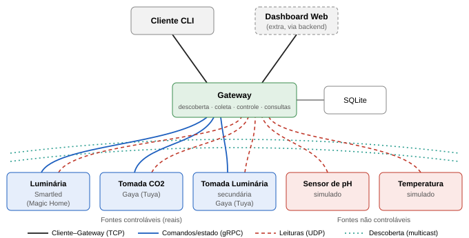

# Aquário Plantado Inteligente

Trabalho de **Sistemas Distribuídos** (UFC, Prof. Dr. Paulo A. L. Rego): um sistema distribuído de monitoramento e controle de um **aquário plantado real**, com Gateway central, fontes de dados e Cliente.

- **Comunicação:** UDP multicast (descoberta), UDP (leituras), gRPC (comandos), TCP (cliente). Tudo serializado com **Protocol Buffers**.
- **Hardware real:** luminária Smartled (Magic Home), duas tomadas Wi-Fi Gaya (Tuya) com medição de energia.
- **Simulados:** sensor de pH (reage ao CO2) e sensor de temperatura.

📄 **Planejamento completo:** [`docs/PLANEJAMENTO.md`](docs/PLANEJAMENTO.md) (PDF: [`docs/planejamento.pdf`](docs/planejamento.pdf))



## Estrutura do repositório

| Pasta | Conteúdo | Responsável |
|---|---|---|
| [`proto/`](proto/README.md) | `aquario.proto`: contrato único (mensagens, serviço gRPC, portas) | equipe |
| [`gateway/`](gateway/README.md) | Gateway: descoberta, UDP, gRPC, TCP, consultas, SQLite (Java) | A (+ C nas consultas) |
| [`fontes/`](fontes/README.md) | Fontes de dados (Python), uma subpasta por processo | B (reais) e C (simulados) |
| [`cliente_cli/`](cliente_cli/README.md) | Cliente de linha de comando (Python) | C |
| [`dashboard/`](dashboard/README.md) | Cliente web com gráficos em Next.js (extra) | D |
| [`scripts/`](scripts/README.md) | Geração de código e subida do sistema inteiro | integração (A) |
| [`docs/`](docs/) | Planejamento, arquitetura | equipe |
| [`apresentacao/`](apresentacao/README.md) | Slides, roteiro e instruções de gravação do vídeo | D |

## Início rápido

```bash
python -m venv .venv && .venv/Scripts/python -m pip install -r requirements.txt
./scripts/gerar_proto.sh            # ou ./scripts/gerar_proto.ps1 no PowerShell
cd gateway && mvn -q package && cd ..
cd dashboard && npm install && cd ..
```

```powershell
./scripts/subir_tudo.ps1 -IpLocal 192.168.0.33 -Backend sim
```

## Regras do repositório

- **Nunca** versionar `fontes/config.json`, `devices.json`, `tinytuya.json` nem `*.db` (já estão no `.gitignore`). As chaves das tomadas ficam só na máquina de quem roda o hardware.
- Código gerado do proto (`gen/`, `gateway/target/`) não vai para o git.
- Cada pessoa trabalha em um branch próprio (`gateway`, `fontes-reais`, `simulados-cli`, `dashboard`) e abre um PR para o `main`.
